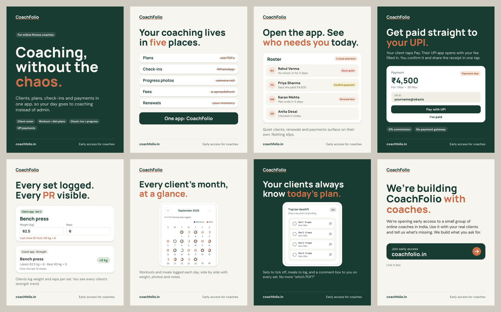
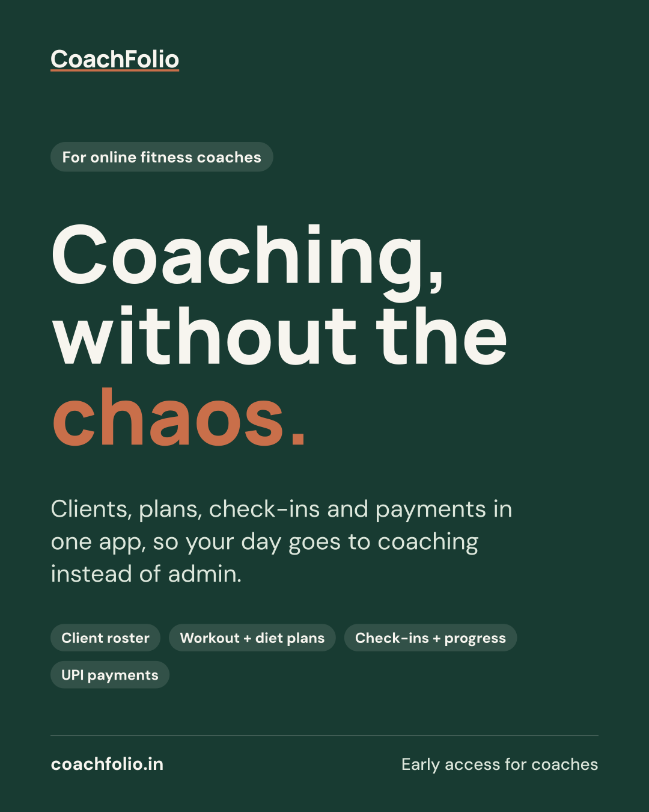
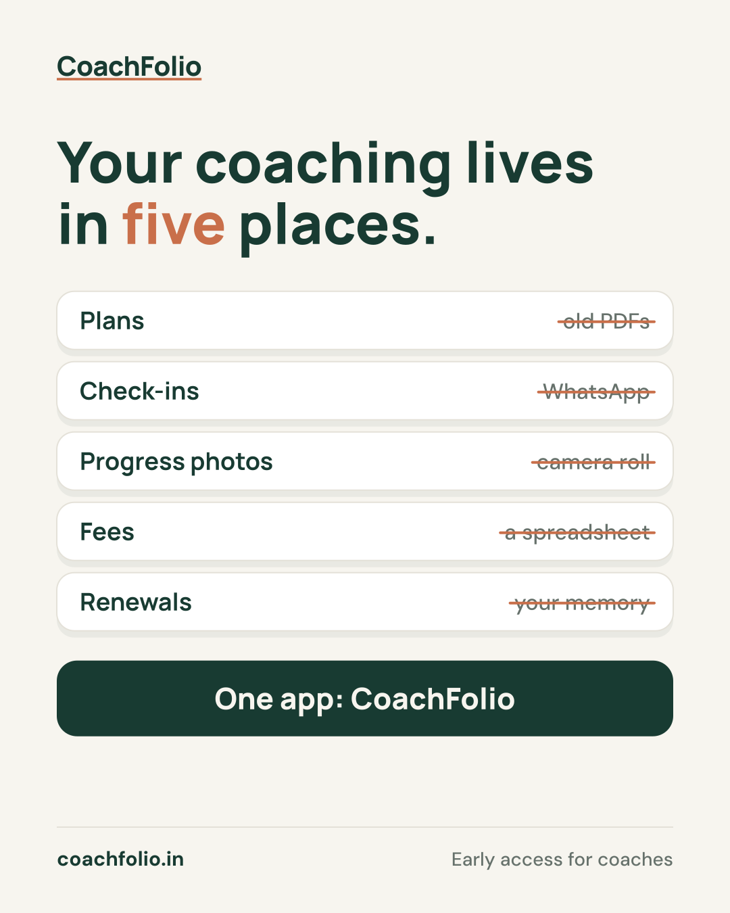
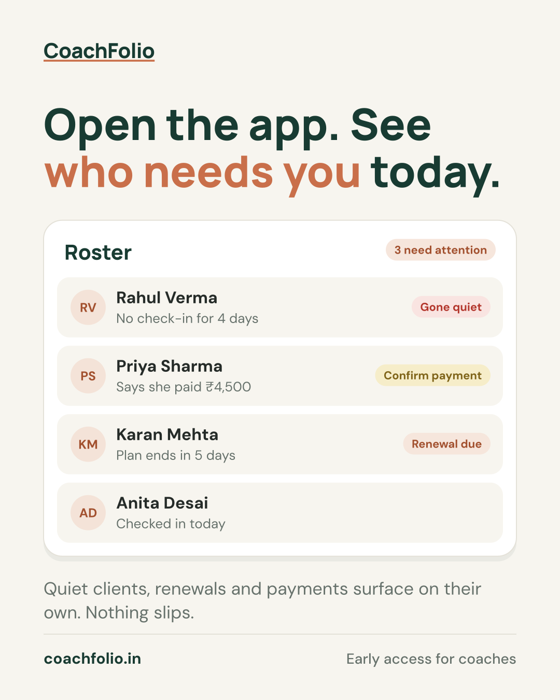
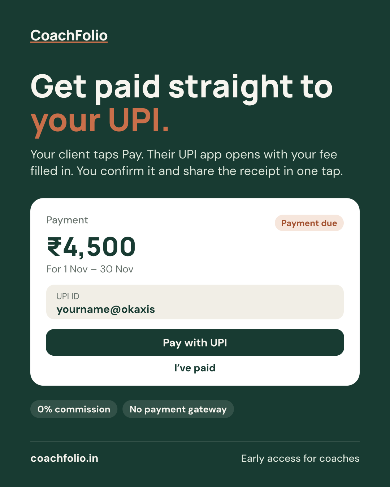
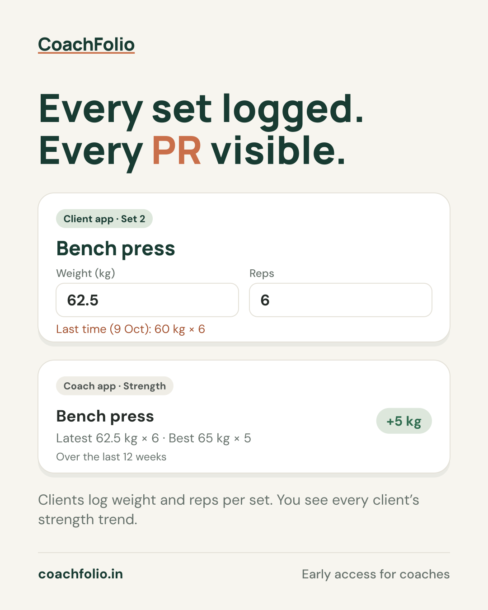
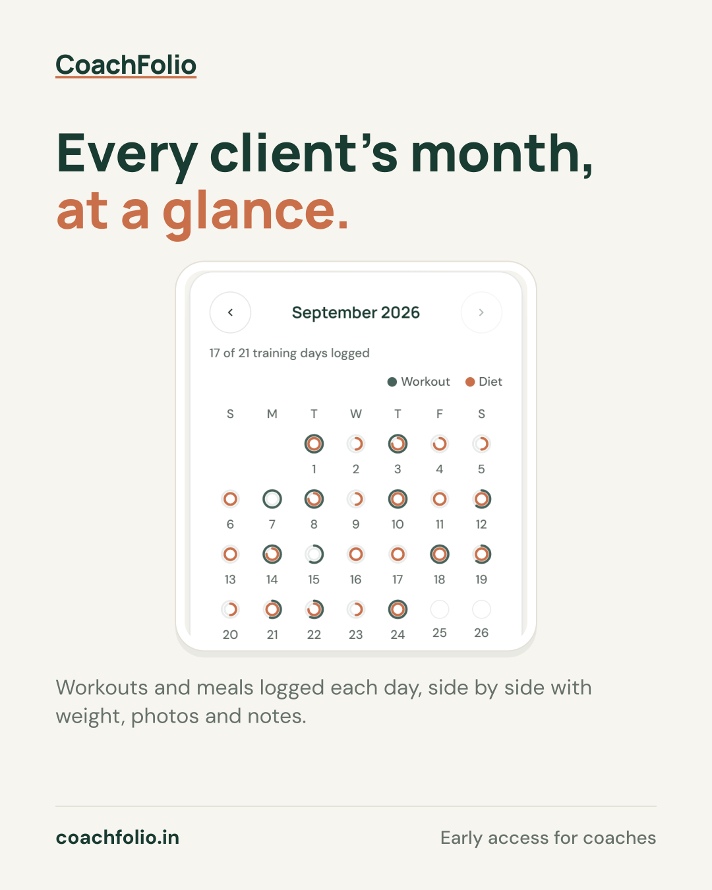
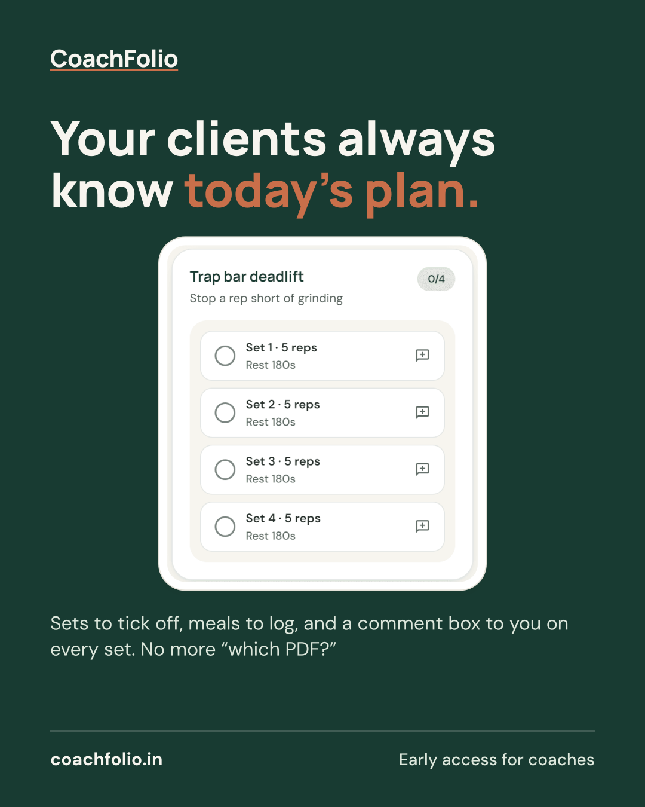
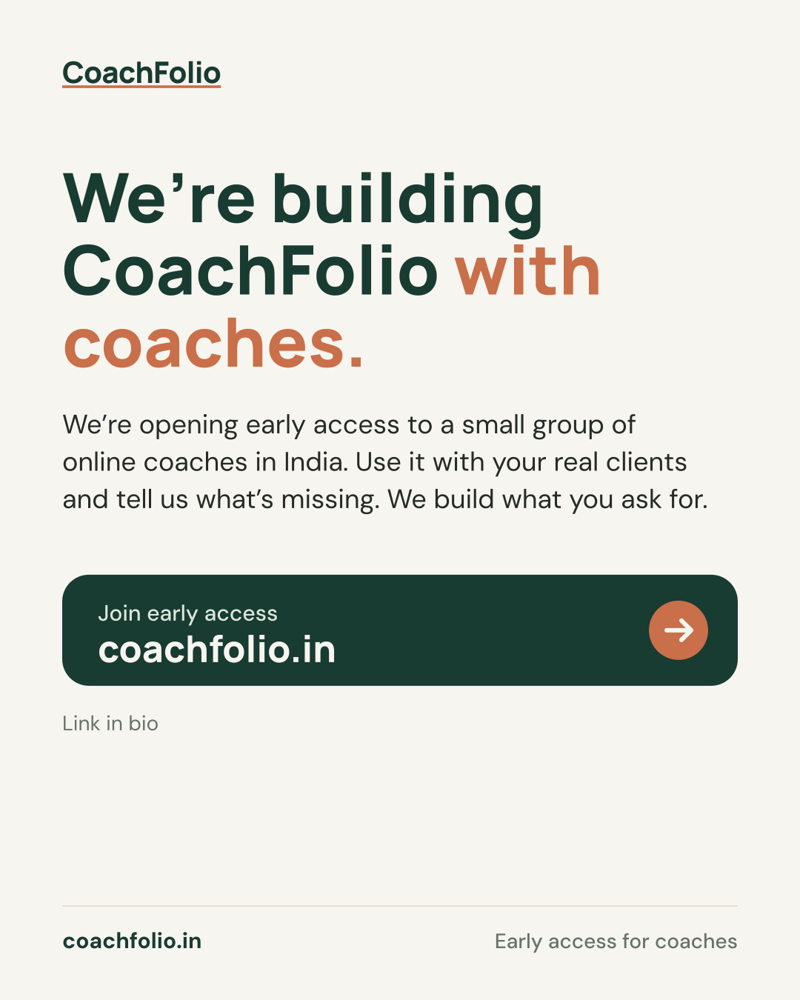

# CoachFolio launch posts: 8 single-image posts

Images are in `launch-posts/`, all **1080×1350 (4:5)**, which works as-is on
Instagram, Facebook and LinkedIn. Rebuild them after any wording change with
`node marketing/social-posts/build-launch-posts.mjs`.

Audience: online fitness coaches in India. CoachFolio is pre-launch, so every
post asks for **early access at coachfolio.in**, never "download now".

## Posting order (3 a week, about 3 weeks)

| # | Day | Post | Why here |
|---|---|---|---|
| 1 | Week 1 Mon | 01 Coaching, without the chaos | Says who it's for and what it is |
| 2 | Week 1 Wed | 02 Your coaching lives in five places | The problem every coach recognises |
| 3 | Week 1 Fri | 04 Get paid straight to your UPI | The strongest hook for Indian coaches |
| 4 | Week 2 Mon | 03 See who needs you today | Daily value |
| 5 | Week 2 Wed | 06 Every client's month, at a glance | Real screenshot, proof it exists |
| 6 | Week 2 Fri | 05 Every set logged | For strength coaches |
| 7 | Week 3 Mon | 07 Your clients always know today's plan | The client side |
| 8 | Week 3 Wed | 08 We're building CoachFolio with coaches | Direct ask |

On Instagram, **pin 01, 04 and 08** to the top of the profile, so a coach who
visits sees what it is, the payments hook, and how to join.

---

## 01: Coaching, without the chaos

**Instagram / Facebook**

> Coaching, without the chaos.
>
> CoachFolio is one app for online fitness coaches: your client roster, workout and diet plans, daily check-ins, progress and UPI payments, all in one place.
>
> Your clients get their own app, so they always know today's workout and meals. You get your evenings back.
>
> We're opening early access to coaches now. Link in bio → coachfolio.in
>
> #OnlineFitnessCoach #FitnessCoachIndia #PersonalTrainer #FitnessBusiness #CoachLife #CoachFolio

**LinkedIn**

> Most online fitness coaches run their business on WhatsApp, PDFs, spreadsheets and calendar reminders. None of it was made for coaching.
>
> We're building CoachFolio: one app for the client roster, workout and diet plans, daily check-ins, progress tracking and UPI payments, with a companion app for clients.
>
> We're opening early access to coaches in India. If you coach online, or know someone who does: coachfolio.in

**X**

> CoachFolio: one app for online fitness coaches. Clients, plans, check-ins, progress and UPI payments, in one place. Early access is open → coachfolio.in

**Alt text:** CoachFolio post on a dark green background: "Coaching, without the chaos." Clients, plans, check-ins and payments in one app, with tags for client roster, workout and diet plans, check-ins and progress, and UPI payments.

---

## 02: Your coaching lives in five places

**Instagram / Facebook**

> Plans in old PDFs. Check-ins in WhatsApp. Progress photos in your camera roll. Fees in a spreadsheet. Renewals in your memory.
>
> Sound familiar? 🙋
>
> CoachFolio puts all five in one app, so finding a client's latest plan takes one tap, not ten minutes of scrolling.
>
> Join early access, link in bio → coachfolio.in
>
> #OnlineCoaching #FitnessCoach #PersonalTrainerIndia #CoachingBusiness #CoachFolio

**LinkedIn**

> Ask an online fitness coach where their client data lives, and the answer is usually five places: plans in PDFs, check-ins in WhatsApp, progress photos in a camera roll, fees in a spreadsheet, renewals in their head.
>
> That's the admin we're taking off coaches' plates with CoachFolio. Early access: coachfolio.in

**X**

> Plans → PDFs. Check-ins → WhatsApp. Photos → camera roll. Fees → spreadsheet. Renewals → memory. Coaching shouldn't live in five places. CoachFolio → coachfolio.in

**Alt text:** A list of five things a coach manages, each crossed out where it lives today: plans in old PDFs, check-ins in WhatsApp, progress photos in the camera roll, fees in a spreadsheet, renewals in memory. Below: One app: CoachFolio.

---

## 03: Open the app. See who needs you today.

**Instagram / Facebook**

> The clients who need you most are the quiet ones.
>
> CoachFolio's roster flags them for you:
> 🔴 Gone quiet: no check-in for a few days
> 🟡 Payment to confirm: they say they've paid
> 🟠 Renewal due: their plan ends this week
>
> Open the app, see who needs you, message them first. Nothing slips.
>
> Early access → link in bio
>
> #ClientRetention #OnlineFitnessCoach #FitnessCoachIndia #CoachingTips #CoachFolio

**LinkedIn**

> Client retention in coaching is mostly about noticing early. The client who stops checking in on Tuesday is the client who doesn't renew next month.
>
> CoachFolio's roster puts the quiet clients, the due renewals and the payments waiting for confirmation at the top, so a coach knows where their attention goes first each morning. Early access: coachfolio.in

**X**

> The clients who need you most are the quiet ones. CoachFolio flags who's gone quiet, whose renewal is due and whose payment to confirm, every morning. coachfolio.in

**Alt text:** A CoachFolio roster card headed "3 need attention". Rahul Verma, no check-in for 4 days, flagged "Gone quiet". Priya Sharma, says she paid ₹4,500, flagged "Confirm payment". Karan Mehta, plan ends in 5 days, flagged "Renewal due". Anita Desai checked in today.

*The names are made up, not real clients.*

---

## 04: Get paid straight to your UPI

**Instagram / Facebook**

> No more chasing "payment kar diya?" on WhatsApp. 💸
>
> In CoachFolio you set the fee once. Your client gets a Pay with UPI button that opens their UPI app (GPay, PhonePe, Paytm…) with your UPI ID and the amount already filled in.
>
> They tap "I've paid", you confirm, and the receipt is shared in one tap. Reminders go out on their own if it's late.
>
> ✅ Money goes straight to your UPI
> ✅ 0% commission
> ✅ No payment gateway to set up
>
> Early access, link in bio
>
> #UPI #FitnessCoachIndia #OnlineCoaching #PersonalTrainer #CoachingBusiness #CoachFolio

**LinkedIn**

> Collecting fees is the most awkward part of coaching for many trainers in India: chasing screenshots on WhatsApp, tracking who has paid in a spreadsheet.
>
> CoachFolio uses the coach's own UPI ID. The client taps Pay, their UPI app opens with the amount filled in, and the coach confirms when it lands. Due and overdue reminders go out automatically. No gateway, no commission: the money never passes through us.
>
> Early access: coachfolio.in

**X**

> Coaches: get paid straight to your UPI. Client taps Pay, their UPI app opens with your fee filled in, you confirm. Auto reminders, receipts, 0% commission. coachfolio.in

**Alt text:** A CoachFolio payment card: ₹4,500 for 1 Nov to 30 Nov, marked "Payment due", showing the coach's UPI ID with a "Pay with UPI" button and an "I've paid" link. Tags read "0% commission" and "No payment gateway".

---

## 05: Every set logged. Every PR visible.

**Instagram / Facebook**

> Progressive overload only works if someone's tracking it. 🏋️
>
> Your clients log the weight and reps for every set, and CoachFolio shows them what they lifted last time, so they know what to beat.
>
> You get a strength view for every client: latest set, best set, and how much they've moved in 12 weeks.
>
> Early access → link in bio
>
> #ProgressiveOverload #StrengthCoach #OnlineFitnessCoach #PersonalTrainer #CoachFolio

**LinkedIn**

> A coach can't adjust what they can't see. In CoachFolio, clients log the weight and reps for each set, see last session's numbers while they train, and the coach gets a per-exercise strength trend for every client.
>
> Early access for coaches: coachfolio.in

**X**

> Clients log weight and reps per set and see "last time: 60 kg × 6" while they train. You see every client's strength trend. Progressive overload, tracked. coachfolio.in

**Alt text:** Two CoachFolio cards. The client app shows set 2 of bench press logged at 62.5 kg for 6 reps, with "Last time: 60 kg × 6". The coach app's strength card shows bench press: latest 62.5 kg × 6, best 65 kg × 5, up 5 kg over 12 weeks.

---

## 06: Every client's month, at a glance

**Instagram / Facebook**

> One screen, one client, one month. 📅
>
> Every ring is a day: green for workouts, orange for meals, filled by how much they actually did. Next to it, their weight trend, photos and notes.
>
> No scrolling back through 300 WhatsApp messages to remember how Priya's month went.
>
> Early access, link in bio
>
> #ClientProgress #OnlineFitnessCoach #FitnessCoachIndia #CoachingBusiness #CoachFolio

**LinkedIn**

> What a coach needs before a weekly review is the shape of the client's month: which days they trained, which they skipped, how their meals went. CoachFolio shows it as one calendar per client, next to their weight trend, photos and notes.
>
> Early access: coachfolio.in

**X**

> One screen, one client, one month. Workouts and meals logged per day, weight, photos and notes alongside. No more scrolling WhatsApp to remember how their month went. coachfolio.in

**Alt text:** A real screenshot of the CoachFolio coach app: a September calendar where each day shows a green ring for workouts and an orange ring for meals, with 17 of 21 training days logged.

---

## 07: Your clients always know today's plan

**Instagram / Facebook**

> "Coach, which PDF was today's workout?" 🙃
>
> With CoachFolio your clients open their app and today's plan is right there: every set to tick off, every meal to log, and a comment box to you on any set ("left knee felt off").
>
> You see it all the moment they save.
>
> Early access, link in bio
>
> #OnlineCoaching #FitnessCoach #PersonalTrainerIndia #ClientExperience #CoachFolio

**LinkedIn**

> The client experience is half of what a coach sells. In CoachFolio, clients get their own app: today's workout set by set, today's meals, and a way to comment to their coach on any set. No PDFs, no "which plan is current?"
>
> Early access: coachfolio.in

**X**

> "Coach, which PDF was today's workout?" never again. Clients open CoachFolio and today's sets and meals are right there, with a comment box to you on every set. coachfolio.in

**Alt text:** A real screenshot of the CoachFolio client app: trap bar deadlift, four sets of 5 reps with 180 seconds rest, each with a checkbox and a comment button.

---

## 08: We're building CoachFolio with coaches

**Instagram / Facebook**

> We're building CoachFolio with coaches, not just for them. 🤝
>
> We're opening early access to a small group of online fitness coaches in India. Use it with your real clients, tell us what's missing, and we'll build it.
>
> If you coach online, or know someone who does, join at coachfolio.in (link in bio). Tag a coach who's drowning in WhatsApp check-ins 👇
>
> #OnlineFitnessCoach #FitnessCoachIndia #PersonalTrainer #FitnessBusiness #EarlyAccess #CoachFolio

**LinkedIn**

> We're opening early access to CoachFolio for a small group of online fitness coaches in India.
>
> What we're asking: use it with your real clients for a few weeks and tell us honestly what's missing. What you get: an app that ends up shaped around how you coach.
>
> If that's you, or someone you know: coachfolio.in

**X**

> We're opening CoachFolio early access to a small group of online fitness coaches in India. Use it with real clients, tell us what's missing, we build it. coachfolio.in

**Alt text:** CoachFolio post: "We're building CoachFolio with coaches." Early access is opening to a small group of online coaches in India. A button reads "Join early access, coachfolio.in".

---

## Before you post

1. **Check coachfolio.in is live** and the early-access form works. Every post sends people there.
2. **Instagram has no clickable links in captions.** Put coachfolio.in in the bio (or a link sticker in Stories).
3. **Post 03's names are made up**, and posts 06 and 07 crop out the demo labels in the screenshots. Keep it that way if you re-crop.
4. **Don't add** user counts, ratings, testimonials or "free" until those are true and decided.
5. **Hashtags:** 5–6 per post is plenty. Rotate them, and add your city (e.g. #DelhiFitnessCoach) if you're targeting locally.
6. **X** crops 4:5 images in the timeline; the headline sits in the top half of every image, so it survives.
